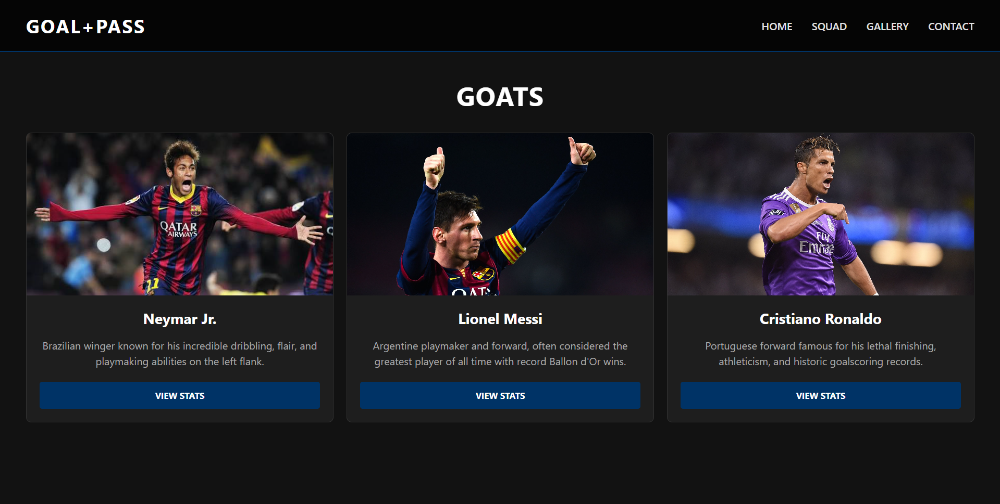
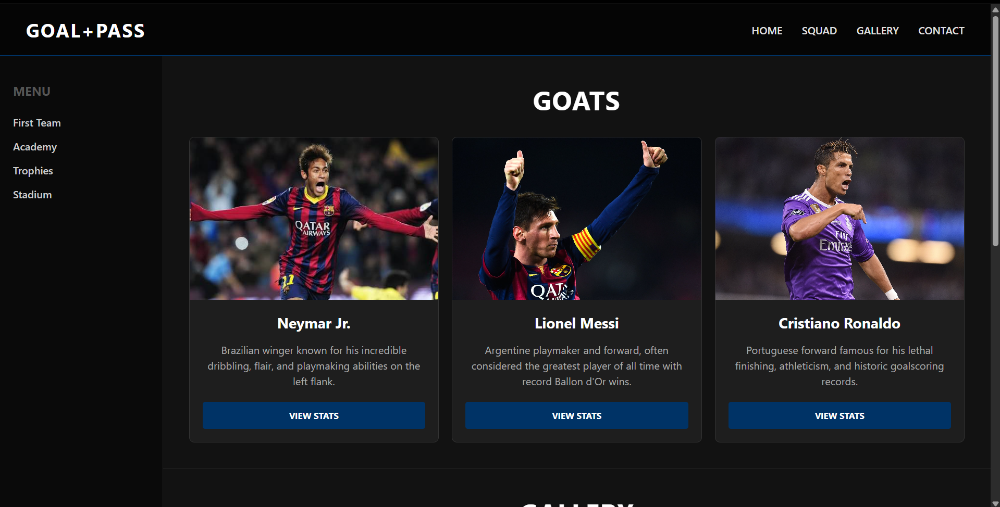
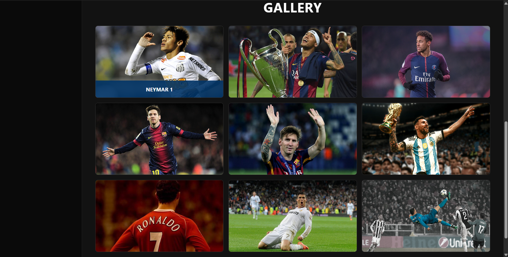
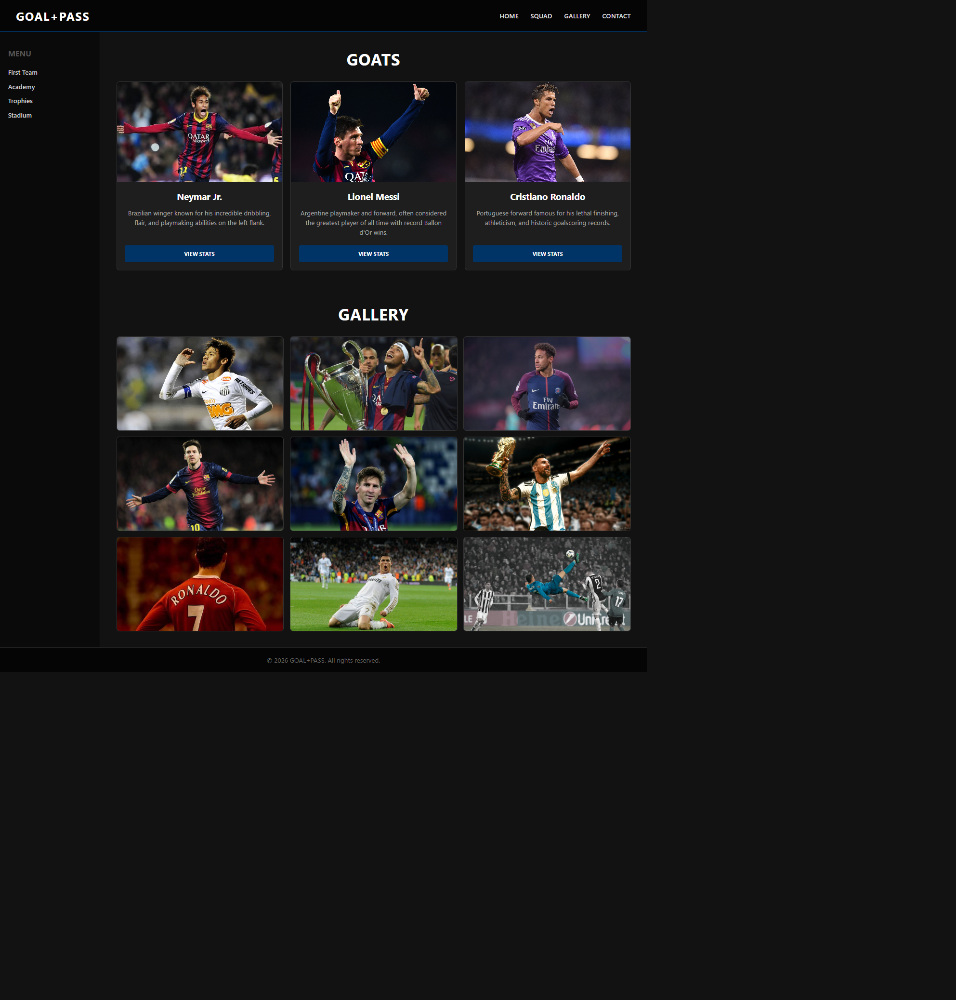

# Assignment 2: Advanced CSS (Flexbox & CSS Grid)

* **Student:** Almansur Maxym
* **Group:** IT-2501
---

## Part 1. Flexbox

### Task 0. Navigation Bar & Task 1. Card Row
* Built a responsive navigation bar using `display: flex`, `justify-content: space-between`, and `align-items: center`.
* Structured player profile cards in a row with `display: flex`, `gap`, and equal height.
* Added hover animations with vertical shift and box-shadow.

---

## Part 2. Grid System

### Task 2. Page Layout with Grid Areas
* Implemented a structured layout containing `header`, `sidebar`, `main`, and `footer` using `grid-template-areas`.
* Defined explicit grid rows and columns for structured navigation.

### Task 3. Image Gallery
* Created a 3x3 grid layout containing 9 football moment photos.
* Implemented smooth zoom effects and slide-up hover overlays for titles.

---

## Part 3. Combining Flexbox & Grid

### Task 4. Portfolio Page
* Combined Flexbox (for navigation and inner card elements) and CSS Grid (for general page layout and image gallery).
* Maintained layout consistency and proper alignment across all sections.

---

## Summary of Work
1. Used Flexbox to build the navigation bar and player cards.
2. Used CSS Grid to create the main page layout and the 3x3 photo gallery.
3. Combined Flexbox and Grid together and styled the page with a dark football theme.